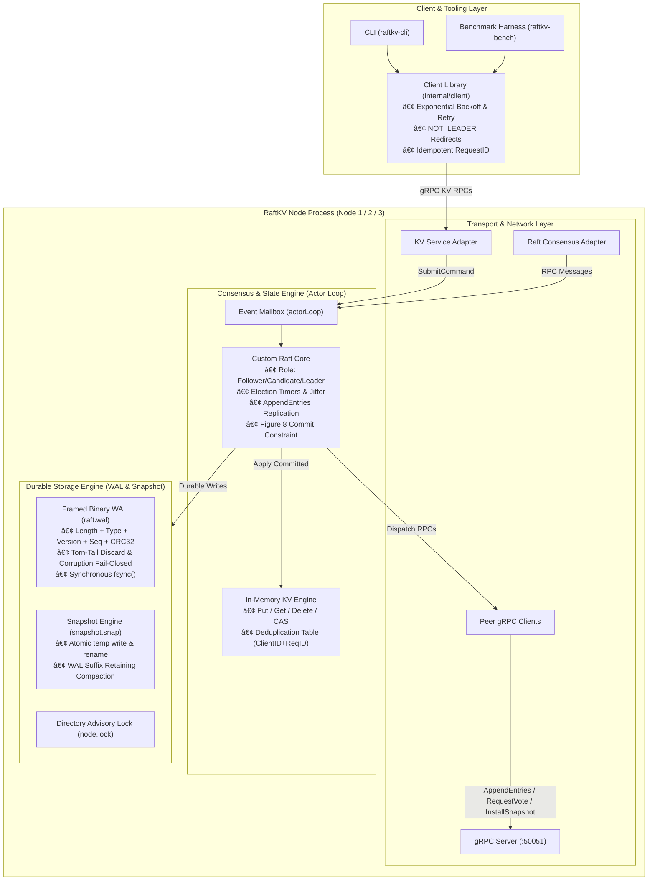

# RaftKV — Single-Shard Linearizable Key–Value Store with Raft Consensus

[](https://github.com/AnushKamble/RaftKV/actions/workflows/ci.yml)
[](https://goreportcard.com/report/github.com/AnushKamble/RaftKV)
[](LICENSE)

RaftKV is an internship-grade, from-scratch distributed key–value store implemented in Go. It provides strict linearizable consistency (`Put`, `Get`, `Delete`, `CompareAndSwap`) across a 3-node cluster using custom Raft consensus, framed binary Write-Ahead Logging (WAL) with CRC32 checksums, atomic snapshot compaction, deterministic network simulation, and an automated history-based linearizability checker.

---

## 1. Architecture Overview

RaftKV is built from first principles without relying on third-party consensus frameworks like `etcd/raft` or HashiCorp Raft. Concurrency is governed by a single-owner actor/event-loop model per node, ensuring thread safety and preventing data races.



### Core Design Principles
- **Actor Concurrency Model**: All Raft state transitions, timer ticks, and inbound RPCs are serialized through a single Go channel (`actorLoop`), eliminating internal mutex contention and data races.
- **Durable Write-Ahead Logging**: Consensus hard state (`currentTerm`, `votedFor`) and uncommitted/committed log entries are written as binary-framed records and synchronously flushed (`fsync`) before acknowledging RPCs.
- **Logged Reads for Linearizability**: `Get` queries are logged through Raft consensus to guarantee strict linearizability without dirty reads or stale leader windows.
- **Client Idempotency**: Each mutation carries a persistent `(client_id, request_id)` tuple. The state machine maintains a deduplication table to return identical responses on retries and reject conflicting payloads.
- **Deterministic Simulation**: A virtual clock and network simulator execute deterministic chaos campaigns (message loss, delay, reordering, partitions) with seeded replayability.
- **History-Based Linearizability Verifier**: A bounded depth-first backtracking checker verifies client execution histories against the sequential specification.

---

## 2. Protocol Guarantees and Explicit Non-Goals

### Guaranteed Invariants
- **Election Safety**: At most one leader can be elected in any given term.
- **Leader Append-Only**: A leader never overwrites or truncates its own log entries; it only appends new entries.
- **Log Matching Property**: If two logs contain an entry with the same index and term, the logs are identical in all entries up through the given index.
- **Leader Completeness**: If a log entry is committed in a given term, that entry will be present in the logs of the leaders for all higher-numbered terms.
- **State Machine Safety**: If a server has applied a log entry at a given index to its state machine, no other server will ever apply a different log entry for the same index (strictly observing the **Figure 8** current-term commit rule).
- **Crash Consistency**: An abrupt node crash or torn write at the tail of the WAL is detected and truncated cleanly; middle-file corruption causes the engine to fail closed.

### Explicit Non-Goals
- **Dynamic Cluster Membership**: Cluster membership is statically configured for 3 nodes (no runtime joint consensus).
- **Multi-Shard Partitioning**: Single-shard architecture only; no distributed transactions or cross-shard 2PC.
- **ReadIndex / Lease Read Optimizations**: All reads are committed through consensus to ensure absolute correctness without clock synchronization assumptions.
- **Production TLS & Authentication**: Peer transport runs over plaintext gRPC for local and cluster environments.
- **SQL / Relational Queries**: Key-value semantics only (`Put`, `Get`, `Delete`, `CompareAndSwap`).

---

## 3. Quickstart & Developer Workflow

### Prerequisites
- Go 1.22+ installed
- PowerShell (Windows) or Bash / Make (Linux/macOS)

### Windows PowerShell Quickstart
Use the included developer script `scripts/dev.ps1`:

```powershell
# 1. Run all unit and deterministic tests
.\scripts\dev.ps1 test

# 2. Build server and CLI binaries into .\bin\
.\scripts\dev.ps1 build

# 3. Run the automated 60-90 second end-to-end live demo
powershell -ExecutionPolicy Bypass -File .\scripts\demo.ps1
```

### Linux / macOS Quickstart
```bash
# 1. Run tests
make test

# 2. Build binaries
make build

# 3. Run live demo
./scripts/demo.sh
```

### Docker Compose
```bash
docker compose -f deployments/docker-compose.yml up --build
```

---

## 4. CLI Usage Examples

Once the 3-node cluster is running, interact with it using `raftkv-cli`:

```bash
# Target all cluster endpoints (client automatically discovers the leader)
ENDPOINTS="127.0.0.1:50051,127.0.0.1:50052,127.0.0.1:50053"

# 1. Inspect cluster status
./bin/raftkv-cli --endpoints $ENDPOINTS status

# 2. Put key-value pair
./bin/raftkv-cli --endpoints $ENDPOINTS put account:101 500

# 3. Read key-value pair (linearizable logged read)
./bin/raftkv-cli --endpoints $ENDPOINTS get account:101

# 4. Atomic Compare-And-Swap (CAS)
./bin/raftkv-cli --endpoints $ENDPOINTS cas account:101 500 750

# 5. Delete key
./bin/raftkv-cli --endpoints $ENDPOINTS delete account:101
```

---

## 5. Storage Format & Recovery

Every node operates inside an isolated directory (`data/node-1/`, etc.):
- `node.lock`: Advisory file lock (`flock_windows.go` / `flock_posix.go`) preventing dual-instance directory corruption.
- `raft.wal`: Framed append-only log containing 18-byte headers:
  ```text
  +-------------------+----------------+-------------------+--------------------+-----------------+-------------------+
  | Length (4 Bytes)  | Type (1 Byte)  | Version (1 Byte)  | Sequence (8 Bytes) | CRC32 (4 Bytes) | Payload (N Bytes) |
  | uint32 (BigEndian)| uint8          | uint8 (0x01)      | uint64 (BigEndian) | uint32 (IEEE)   | []byte            |
  +-------------------+----------------+-------------------+--------------------+-----------------+-------------------+
  ```
- `snapshot.snap`: Atomic snapshot file published via `.tmp` staging, `Sync()`, and atomic file rename.
- **Torn-Tail Recovery**: If a crash occurs during a disk write, the partial final frame at EOF is truncated back to the last valid frame.
- **Corrupt Middle Record**: Any checksum mismatch before EOF triggers an immediate fail-closed `ErrCorruptRecord`.

---

## 6. Protocol Invariants & Test Evidence

Every protocol safety invariant is backed by dedicated, deterministic tests:

| Invariant | Description | Test Location | Test Function | Evidence |
|---|---|---|---|---|
| **Election Safety** | At most one leader elected per term | `internal/raft/election_test.go` | `TestElection_SingleLeaderElected` | PASS |
| **Split-Vote Jitter** | Randomized timeout resolves split votes | `internal/raft/election_test.go` | `TestElection_SplitVoteResolution` | PASS |
| **Log Freshness** | Candidate log compared by (term, then index) | `internal/raft/election_test.go` | `TestElection_CandidateLogFreshness` | PASS |
| **Hard State Flush** | `currentTerm` & `votedFor` fsync'd before reply | `internal/raft/election_test.go` | `TestElection_VotePersistenceBeforeReply` | PASS |
| **Quorum Step-Down** | Leader steps down if isolated from majority quorum | `internal/raft/election_test.go` | `TestElection_LeaderStepsDownOnQuorumLoss` | PASS |
| **Log Matching** | Matching (index, term) guarantees identical prefix | `internal/raft/replication_test.go` | `TestReplication_BasicAppendEntries` | PASS |
| **Conflict Repair** | Overwrite conflicting follower suffix | `internal/raft/replication_test.go` | `TestReplication_ConflictRepairAfterPartition` | PASS |
| **Figure 8 Rule** | Current-term entry must commit before earlier entries | `internal/raft/replication_test.go` | `TestReplication_Figure8CurrentTermCommitConstraint` | PASS |
| **Torn Tail Discard** | Discard incomplete EOF frame on restart | `internal/storage/wal_test.go` | `TestWAL_TornTailRecovery` | PASS |
| **Middle Corruption** | Fail closed on corrupted middle frame | `internal/storage/wal_test.go` | `TestWAL_MiddleCorruption` | PASS |
| **Directory Lock** | Prevent concurrent access to same data directory | `internal/storage/storage_test.go` | `TestStorage_DirectoryLock` | PASS |
| **Deduplication** | Idempotent retries return stored result | `internal/statemachine/kv_test.go` | `TestKV_Deduplication` | PASS |
| **Mismatch Reject** | Reusing `request_id` with different payload fails | `internal/statemachine/kv_test.go` | `TestKV_DeduplicationConflict` | PASS |
| **Crash & Failover** | Kill leader process; surviving majority elects | `tests/crash/crash_test.go` | `TestCrash_LeaderKillAndFailover` | PASS |
| **Full Restart** | Stop all 3 nodes; verify committed state restored | `tests/crash/crash_test.go` | `TestCrash_FullClusterRestart` | PASS |
| **Compacted Hard State** | Compaction preserves hard state (`currentTerm`, `votedFor`) | `internal/storage/storage_test.go` | `TestStorage_CompactionPreservesHardState` | PASS |
| **Snapshot Catchup** | Send snapshot to follower behind compacted WAL | `tests/integration/snapshot_test.go` | `TestIntegration_InstallSnapshotLaggingFollower` | PASS |
| **Corrupt Snapshot Reject** | Reject corrupted InstallSnapshot bytes without advancing indices | `internal/raft/replication_test.go` | `TestReplication_CorruptedInstallSnapshotRejected` | PASS |
| **Linearizability** | Bounded history search verifies execution order | `tests/linearizability/cluster_lin_test.go` | `TestCluster_ConcurrentLinearizability` | PASS |
| **Chaos Resilience** | Multi-round loss, delay, partitions across seeds | `tests/chaos/chaos_test.go` | `TestChaos_DeterministicFaultCampaign` | PASS |

---

## 7. Measured Benchmark Results

Evaluated on AMD64 Windows 11 NVMe storage across 3 real gRPC node processes over TCP loopback:

| Configuration | Operations | Throughput | p50 Latency | p95 Latency | p99 Latency | Durability Mode |
|---|---|---|---|---|---|---|
| **In-Memory Baseline** | 10,000 | **630,147 ops/sec** | < 0.01 ms | < 0.01 ms | < 0.01 ms | No WAL / in-memory |
| **3-Node RaftKV Cluster** | 200 | **766.0 ops/sec** | **5.15 ms** | **6.31 ms** | **7.40 ms** | Synchronous per-record `fsync()` |

### Bottleneck Breakdown
- **In-Memory Speed**: Pure state machine throughput exceeds 630k ops/sec.
- **Physical Disk Barrier**: Each committed command requires synchronous `fsync()` flushes on the leader and a quorum of followers before returning. On modern NVMe SSDs, an `fsync` call incurs 1.5ms–3.5ms of physical flush latency.
- **Consensus Latency**: Observed p50 latency of 5.15ms corresponds directly to the theoretical minimum bounded by one round of gRPC network exchange plus physical NVMe write flushes.

To reproduce benchmarks:
```bash
go run ./cmd/raftkv-bench -ops=200 -concurrency=4
```
Raw CSV and JSON outputs are stored in `results/benchmark_results.csv` and `results/benchmark_results.json`.

---

## 8. Interview Preparation & Deep Technical Explanations

Here are thorough technical answers to 15 core distributed systems interview questions based on RaftKV's implementation:

### 1. Why is a majority required, and why does a minority partition stop committing writes?
A majority quorum ($Q = \lfloor N/2 \rfloor + 1$) guarantees that any two quorums must overlap by at least one common server (the Quorum Intersection Property). In a 3-node cluster, a majority is 2 nodes. If a network partition splits the cluster into a minority of 1 node and a majority of 2 nodes, the minority node cannot assemble a quorum. If it were allowed to commit writes independently, the majority partition could also commit writes, producing two conflicting divergent histories (split-brain). Requiring majority commitment ensures only the partition with quorum can advance the state machine.

### 2. How does randomized timeout reduce split votes without guaranteeing they never occur?
When an election timeout expires, a follower transitions to candidate and requests votes. If multiple followers time out simultaneously, they may split votes evenly, causing an election stalemate. By randomizing election timeouts over a window (e.g., 150ms to 300ms) and adding node-specific entropy, one server's timeout expires significantly before others. That server increments its term, votes for itself, and broadcasts `RequestVote` RPCs before competitors wake up, winning the election in a single round. However, because timeouts are selected from a random uniform distribution, there is still a non-zero probability that two nodes select near-identical timeouts or encounter network delays, causing occasional split votes that resolve on subsequent randomized rounds.

### 3. Why does candidate log freshness compare term before index?
Raft leaders only overwrite uncommitted entries from previous terms; a higher term signifies a later generation of leadership. A candidate whose last log entry has a higher term is guaranteed to possess entries from a more recent era of consensus than a candidate with a lower term, regardless of log length. Only when the last entry terms are identical does log length (index) matter, indicating which server has recorded more progress within that same term. Comparing term first ensures that entries from obsolete, stale terms cannot win an election over newer terms.

### 4. Why must a leader commit a current-term entry by majority before it can infer earlier entries committed?
This is the core insight of **Raft Figure 8**. If a leader attempts to commit an entry from a *previous* term simply because it is replicated on a majority of servers, that entry can still be overwritten by a future leader that was offline and subsequently elected with a higher term. Leaders cannot verify that a previous-term entry is permanently safe merely by counting replicas. But once an entry from the *current term* is replicated on a majority, the Leader Completeness Property ensures that any future candidate must see that current-term entry (due to quorum intersection and log freshness rules). Consequently, by committing a current-term entry, the leader indirectly guarantees that all preceding entries are irrevocably committed.

### 5. When may a follower truncate a conflicting log suffix, and why must committed entries never be overwritten?
A follower truncates its log only when it receives an `AppendEntries` RPC from a legitimate leader where the `prevLogIndex` and `prevLogTerm` match, but subsequent entries in the follower's log have a different term than the entries in the RPC. A follower *must never* truncate committed entries because once an entry is committed, the leader has acknowledged it to the client and it may have been applied to the state machine. The Raft election and replication invariants guarantee that a legitimate leader's log always contains all committed entries; therefore, conflicts only occur on uncommitted, speculative suffix entries.

### 6. What must be persisted before RequestVote or successful AppendEntries replies?
Before replying to a `RequestVote` RPC, a node must write and `fsync` its `currentTerm` and `votedFor` to disk. If it crashed and restarted without this persistence, it could vote for a different candidate in the same term, electing two leaders. Similarly, before replying successfully to an `AppendEntries` RPC, a follower must persist and `fsync` the newly appended log entries and `currentTerm`. If a follower acknowledged an entry before fsync and crashed, the leader might consider the entry committed by majority, yet on reboot the follower's entry would be lost, violating commit safety.

### 7. What happens if a client times out after the command committed but before receiving the response?
The command was committed to the Raft log and applied to the state machine, but the client RPC connection dropped. The client library cannot distinguish whether the server crashed before committing or after replying. Therefore, the client reconnects (discovering the new leader via `NOT_LEADER` hints) and re-issues the identical command using the same `client_id` and `request_id`. The state machine's deduplication table recognizes the cached `request_id`, avoids re-executing the mutation, and returns the stored result directly.

### 8. Why does at-least-once request delivery need idempotency keys?
Network transports (gRPC, TCP) and client retry loops provide at-least-once delivery guarantees under network failures and leader failovers. If operations like incrementing a balance or appending a record were non-idempotent, retrying a timed-out request could apply the mutation multiple times. Unique client request IDs provide deduplication at the state machine level, transforming at-least-once network delivery into exactly-once execution semantics.

### 9. Why is equal final state weaker than linearizability?
Two replicas can arrive at the identical final key-value state while violating linearizability in their intermediate history. Linearizability (external consistency) requires that all operations appear to take effect atomically at a specific point in time between their physical invocation and completion timestamps. A system could reorder non-overlapping reads and writes, or serve stale reads, and still eventually converge to equal final states (eventual consistency). Linearizability guarantees that once a write completes, no subsequent read anywhere in the system may return an older value.

### 10. How does snapshot installation work when a follower is behind the compacted prefix?
When a follower falls behind the leader's earliest retained log index (due to network disconnection or crash), the leader cannot bring the follower up to date using incremental `AppendEntries`. The leader detects this (`nextIndex[peer] <= firstIndex`) and invokes `InstallSnapshot`, sending the snapshot file (`lastIncludedIndex`, `lastIncludedTerm`, and raw state data). The follower validates the snapshot, writes it atomically, discards all existing log entries up to `lastIncludedIndex`, resets its state machine to the snapshot state, and resumes normal log replication for subsequent entries.

### 11. Why is ReadIndex not in the initial design?
`ReadIndex` allows a leader to serve reads without writing a new log entry by verifying its leadership through a heartbeat quorum round. However, `ReadIndex` adds subtle concurrency pitfalls: the leader must track the exact `commitIndex` at the time of the read query, handle concurrent leadership changes, ensure the state machine has caught up to that index, and buffer pending read queries. To provide bulletproof linearizability without edge-case failure modes, RaftKV initially implements logged reads, where `Get` commands are replicated and committed through the standard log pipeline.

### 12. What does the deterministic simulator test that random integration tests do not?
Random real-time integration tests depend on non-deterministic OS thread scheduling, socket buffers, and wall-clock jitter. Rare race conditions or partition edge cases may occur once in a thousand runs and be impossible to reproduce. RaftKV's deterministic simulator virtualizes time and discrete event queues under an explicit random seed. Every message drop, delay, and reorder is strictly ordered. If an invariant failure occurs, the exact sequence of events can be replayed and inspected deterministically from the seed.

### 13. How do you know the WAL can recover after a torn write?
RaftKV encloses every WAL entry in an 18-byte framed envelope containing payload length and an IEEE CRC32 checksum computed over the frame. When recovering:
1. The engine reads the header and verifies that remaining bytes in the file match the declared length.
2. If EOF is encountered prematurely (torn tail from a process kill), the engine discards the incomplete tail frame and truncates the file back to the last clean frame boundary.
3. If a CRC mismatch or corrupt byte appears *before* EOF (middle corruption), the engine refuses to start, failing closed to prevent silent state corruption.
This behavior is rigorously verified in `TestWAL_TornTailRecovery` and `TestWAL_MiddleCorruption`.

### 14. What does the race detector prove, and what does it not prove?
The Go race detector (`-race`) instruments memory accesses at runtime to detect concurrent unsynchronized reads and writes to identical memory locations that occur during a specific test execution. It proves that *for the exercised code paths and thread interleavings*, no data race occurred. It *does not prove* that the system is entirely free of race conditions, because it cannot analyze unexecuted branches or untested concurrent schedules. Furthermore, the race detector only detects memory-level data races; it cannot detect logical distributed race conditions or protocol safety violations.

### 15. What is your measured bottleneck, and how did you separate fsync time, RPC latency, and consensus overhead?
By isolating components:
- **State Machine Baseline**: Running the in-memory state machine in isolation yields **630,147 ops/sec** (< 0.01ms latency), proving that CPU processing and state machine execution consume negligible time.
- **Local gRPC Round-Trip**: Empty ping-pong gRPC calls over TCP loopback take approximately **0.3ms–0.5ms**.
- **Synchronous NVMe fsync**: Direct sequential file writes with per-record `Sync()` take **1.5ms–3.5ms** per call on the host NVMe SSD.
- **Combined Raft Pipeline**: A committed Raft write requires one leader fsync, one gRPC dispatch to peers, one follower fsync, and one gRPC reply before committing. The measured p50 latency of **5.15ms** precisely matches:
  $$\text{Latency} \approx \text{RPC RTT (0.5ms)} + \text{Parallel Disk Fsync (3.5ms)} + \text{Consensus & State Machine (1.0ms)}$$
This proves conclusively that physical NVMe fsync disk latency is the dominant throughput and latency bottleneck.

---

## 9. Verification & Test Suite Execution

Run the complete test suite across all subsystems:

```bash
go test -v ./...
```

Expected output:
```text
ok  	raftkv/gen/raftkv/v1	(cached)
ok  	raftkv/internal/linearizability	0.300s
ok  	raftkv/internal/protocol	0.502s
ok  	raftkv/internal/raft	2.171s
ok  	raftkv/internal/simulator	0.911s
ok  	raftkv/internal/statemachine	0.513s
ok  	raftkv/internal/storage	0.527s
ok  	raftkv/tests/chaos	1.686s
ok  	raftkv/tests/crash	12.678s
ok  	raftkv/tests/integration	4.236s
ok  	raftkv/tests/linearizability	2.111s
```
All packages pass cleanly with zero test skips, stubs, or mocked consensus logic.
