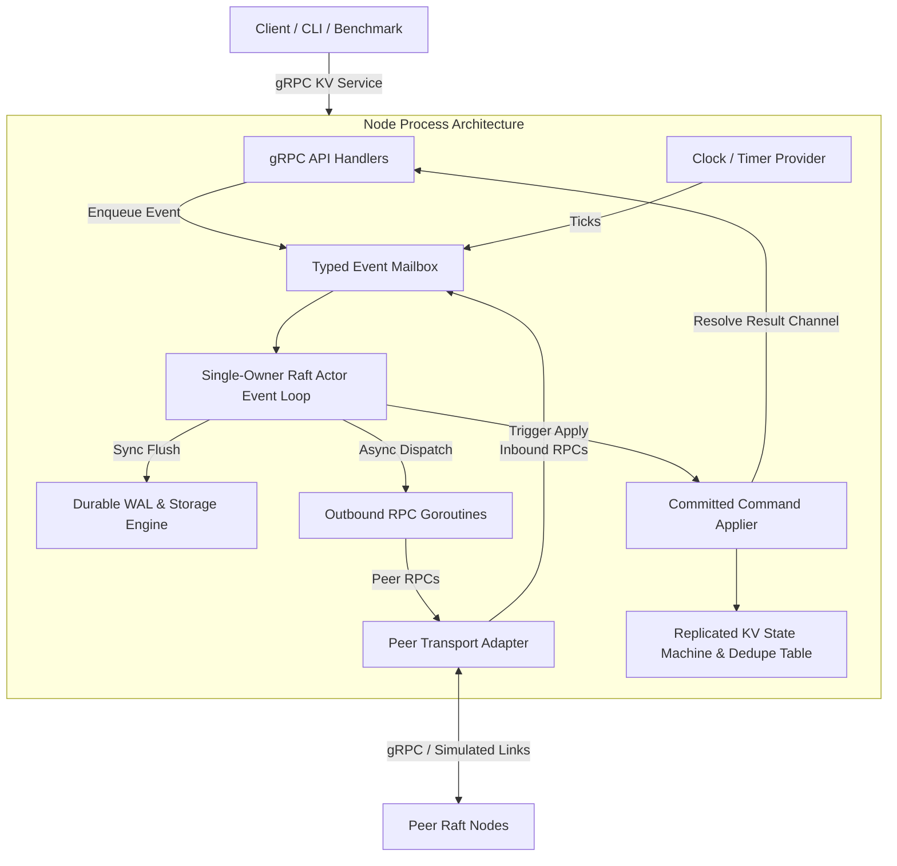

# RaftKV — Architecture & Component Design

## 1. System Overview

---

## 2. Component Boundaries & Concurrency Model

### 2.1 Single-Owner Event Loop (Actor Model)
- **Role**: Sole owner of mutable Raft state (`currentTerm`, `votedFor`, `log`, `commitIndex`, `lastApplied`, `role`, `nextIndex`, `matchIndex`, `pendingRequests`).
- **No Mutex Contention**: All protocol transitions happen in a single thread execution loop reading from a Go channel `mailbox chan Event`.
- **Race Free**: Passes Go race detector (`go test -race ./...`) by construction.

### 2.2 Storage Engine & WAL
- Synchronously written during event loop processing before emitting protocol responses.
- Frame-level CRC32 checksums guarantee record integrity.
- Atomic directory lock prevents double-instantiation.

### 2.3 Replicated State Machine & Applier
- Entries committed by Raft consensus are streamed monotonically to the state machine applier.
- `lastApplied` strictly advances from $0 \dots \text{commitIndex}$.
- Evaluates operation (Put, Get, Delete, CAS), checks/updates deduplication table, and sends result to the waiting client channel.

### 2.4 Clock & Transport Abstractions
- Production environment uses standard `time.Timer` and real gRPC network channels.
- Simulator environment replaces `Clock` and `Transport` with virtual time and an in-memory packet scheduler for deterministic chaos testing.

---

## 3. Durable-Write-Before-Response Rules

| Event | Required Sync Before Response | Invariant Protected |
|---|---|---|
| Step down on higher term | Sync `currentTerm`, clear `votedFor` | Prevent voting with stale term |
| Start election | Sync incremented `currentTerm`, `votedFor = self` | Single vote per term across restart |
| Grant vote (`RequestVote`) | Sync `votedFor = candidate` | Prevent double voting across restart |
| Accept log entries (`AppendEntries`) | Sync suffix truncation & appended entries | Prevent losing accepted log prefix |
| Propose command (Leader) | Sync new log entry locally before replicating | Prevent losing uncommitted leader entry |
| InstallSnapshot | Flush snapshot file, sync snapshot marker | State machine recovery base consistency |

---

## 4. Snapshot & WAL Crash Ordering

1. **Snapshot Creation**:
   - Leader/follower pauses log compaction and captures state machine + dedupe table at `lastIncludedIndex <= lastApplied`.
   - Serializes payload with checksum to `snapshot.tmp`.
   - Flushes and fsyncs `snapshot.tmp`.
   - Atomically renames `snapshot.tmp` to `snapshot.snap`.
2. **Log Compaction**:
   - Opens a new temporary WAL `wal.tmp`.
   - Writes `RecordSnapshotMeta` with `(lastIncludedIndex, lastIncludedTerm)`.
   - Copies remaining suffix log entries (`index > lastIncludedIndex`) to `wal.tmp`.
   - Flushes and fsyncs `wal.tmp`.
   - Atomically renames `wal.tmp` to replace primary WAL.
3. **Crash Recovery Order**:
   - If `snapshot.tmp` exists without being renamed: discarded; previous state is intact.
   - If `wal.tmp` exists without being renamed: discarded; old WAL is valid.
   - On startup: load `snapshot.snap` (if present), then replay `wal.wal` from snapshot base index forward.
